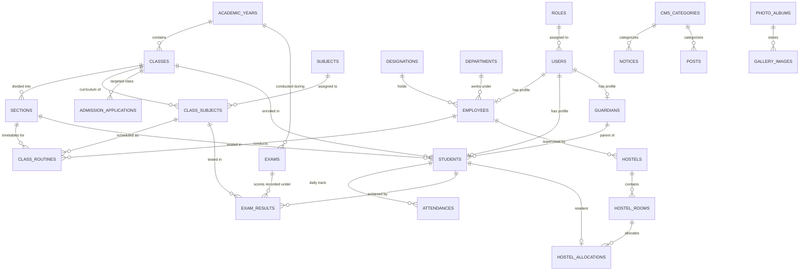

# Naafein International Academy (NIA) - Architecture & System Blueprint

[](https://www.nia.edu.bd/)
[](https://www.nia.edu.bd/)
[](https://www.nia.edu.bd/)

This repository contains the architecture blueprint, database schema (Entity-Relationship diagram), folder structure, and complete public UI map for **Naafein International Academy (NIA)** ([www.nia.edu.bd](https://www.nia.edu.bd/)), an English Medium Islamic School in Dhaka, Bangladesh offering integrated general and Hifzul Quran education.

---

## 📑 Table of Contents

1. [System Architecture Overview](#-system-architecture-overview)
2. [Public UI Architecture & Wireframe](#-public-ui-architecture--wireframe)
3. [Entity Relationship (ER) Diagram](#-entity-relationship-er-diagram)
4. [Enterprise Project Folder Structure](#-enterprise-project-folder-structure)
5. [Core Functional Modules](#-core-functional-modules)
6. [Detailed Documentation Links](#-detailed-documentation-links)

---

## 🏛️ System Architecture Overview

The system is constructed as a dual-layer institutional platform:
1. **Public Institutional Web Portal**: A visitor-facing CMS delivering institutional details, breaking news, leadership messages, public notice archives, interactive class routines, an academic calendar, staff directories, and an online admission engine.
2. **School Management System (SMS) & Portals**: Role-protected workspaces for **Students**, **Teachers**, and **Super Administrators** covering attendance, exam marks, grade evaluation, hostel allotments, and fee statuses.

---

## 🖥️ Public UI Architecture & Wireframe

For full details, review [docs/public/PUBLIC_UI_MAP.md](docs/public/PUBLIC_UI_MAP.md).

```mermaid
graph TD
    classDef shell fill:#0f172a,stroke:#38bdf8,stroke-width:2px,color:#fff;
    classDef section fill:#1e293b,stroke:#818cf8,stroke-width:1px,color:#f8fafc;
    classDef subpage fill:#0369a1,stroke:#38bdf8,stroke-width:1px,color:#fff;
    classDef modal fill:#831843,stroke:#f43f5e,stroke-width:1px,color:#fff;

    AppShell[PUBLIC WEB APPLICATION SHELL]:::shell

    TopBar[1. Desktop Top Bar<br/>• Hotline: 01805023220-22<br/>• Quick Portal Links]:::section
    LogoHeader[2. Institution Brand Header<br/>• Academy Logo & EIIN: 310010467<br/>• Social Profiles & Play Store Link]:::section
    Navbar[3. Global Navbar & Offcanvas Mobile Drawer]:::section
    Footer[4. Footer & Contact Strip<br/>• Address, Education Board Links<br/>• Play Store App & Developer Info]:::section

    AppShell --> TopBar
    AppShell --> LogoHeader
    AppShell --> Navbar
    AppShell --> Footer

    %% Modals
    TopBar -.-> StudentModal[Modal: Student Portal Login]:::modal
    TopBar -.-> TeacherModal[Modal: Teacher Portal Login]:::modal
    LogoHeader -.-> ApkModal[Modal: Install Official App]:::modal
    AppShell -.-> YtModal[Modal: YouTube Video Player Lightbox]:::modal

    %% Navigation
    Navbar --> P_Home["Home (/)"]:::subpage
    Navbar --> P_About["About Us (/about)"]:::subpage
    Navbar --> P_Admin["Administration"]:::subpage
    Navbar --> P_Acad["Academic"]:::subpage
    Navbar --> P_Curr["Curriculum"]:::subpage
    Navbar --> P_Disc["Discipline"]:::subpage
    Navbar --> P_CoCurr["Co-Curricular"]:::subpage
    Navbar --> P_Adm["Admission (/online/admission-v2)"]:::subpage
    Navbar --> P_Hostel["Hostel"]:::subpage
    Navbar --> P_Gal["Gallery (/gallery)"]:::subpage
    Navbar --> P_Contact["Contact (/contact-us)"]:::subpage
```



### Homepage Component Layout Summary

1. **Top Bar**: Contact hotline, email, modal login triggers for students and teachers.
2. **Brand Header**: Academy seal, full name, EIIN, campus location, social links, Google Play app download badge.
3. **Main Nav**: 11 Primary menus with dropdown subpages.
4. **News Ticker**: Real-time breaking marquee announcements.
5. **Hero & Notice Board**: Split carousel banner + scrollable notice board.
6. **Principal & Chairman Messages**: Leadership profiles and statements.
7. **Institution History**: Foundation history and academic philosophy.
8. **Faculty Slider**: Teachers showcase with photos, titles, and profile links.
9. **Quick Facts Strip**: Parallax counter displaying foundation year, student count, and faculty stats.
10. **Education Corner**: Quick action tiles for attendance, routine, results, and fees.
11. **Citizen Charter & Facebook Timeline**: Government service links (NIS, APA, GRS, RTI) + Facebook widget + Event countdown timer.
12. **Events Grid**: Upcoming and recent academy events.
13. **Video Gallery**: YouTube carousel with responsive video lightbox.
14. **Institutional Directory**: Dynamic AJAX tabbed directory of teachers and governing body members.
15. **Dashboard Deck**: Student merit highlights and weekly school hours.
16. **Photo Gallery & Blogs**: Photo album slider and latest editorial articles.
17. **Footer**: Floating contact pill, useful education board links, and mobile app download.

---

## 📊 Entity Relationship (ER) Diagram

For full schema details, review [docs/public/ER_DIAGRAM.md](docs/public/ER_DIAGRAM.md).



---

## 📁 Enterprise Project Folder Structure

For complete directory file paths, review [docs/public/FOLDER_STRUCTURE.md](docs/public/FOLDER_STRUCTURE.md).

```plaintext
nafein-academy/
├── app/
│   ├── Console/Commands/
│   ├── Http/
│   │   ├── Controllers/
│   │   │   ├── Admin/            # Admin Backoffice Controllers
│   │   │   ├── Api/              # AJAX & Mobile API Controllers
│   │   │   ├── Auth/             # Authentication & Modal Logins
│   │   │   ├── Portal/           # Student & Teacher Portals
│   │   │   └── Web/              # Public Website Pages
│   │   ├── Middleware/           # Auth Guards & Roles
│   │   └── Requests/             # Input Validations
│   ├── Models/                   # Eloquent Entities
│   └── Services/                 # Domain Services (Admissions, Uploads, Results)
├── config/                       # Application & Cloud Storage Config
├── database/
│   ├── migrations/               # Schema Migrations
│   └── seeders/                  # Initial Academic & Role Seeds
├── public/
│   ├── assets/                   # Theme Stylesheets, Splide, AOS, Images
│   └── index.php
├── resources/
│   ├── js/
│   └── views/                    # Blade Templates (Admin, Portal, Web, Modals)
├── routes/
│   ├── admin.php                 # Administrative Routes
│   ├── api.php                   # API Endpoints
│   ├── auth.php                  # Authentication Routes
│   ├── portal.php                # Student / Teacher Portals
│   └── web.php                   # Public Website Routes
└── storage/
```

---

## 📦 Core Functional Modules

* **Curriculum Management**: Early Years (EY), Primary Years (PYP), Middle Years (MYP), High Years (HYP), and Hifzul Quran.
* **Online Admission System**: Digital application pipeline with document uploads and application tracking.
* **Faculty Directory**: Dynamic teacher listing with profile cards and designation tags.
* **Examinations & Results**: Terminal exam grade calculation and online marksheet verification.
* **Notice Board & Events**: Pinned circulars, PDF downloads, and upcoming events countdown.
* **Residential & Hostel Management**: House master and house tutor assignments and bed allocations.

---

## 🔗 Detailed Documentation Links

### 🌐 Public Portal Architecture
* 📄 [Public UI Map & Wireframe Specification](docs/public/PUBLIC_UI_MAP.md)
* 📊 [Complete Entity Relationship (ER) Diagram](docs/public/ER_DIAGRAM.md)
* 📁 [Project Folder Structure & Codebase Architecture](docs/public/FOLDER_STRUCTURE.md)

### 🔐 Authenticated Portals (Pending Access)
* 🔒 [Student & Teacher Portals Documentation (WIP)](docs/portals/README.md)

---

### License & Attribution
Designed for **Naafein International Academy**. Licensed under the [MIT License](LICENSE).
