# Naafein International Academy (NIA) - Entity Relationship (ER) Diagram

> **Reference Website**: [https://www.nia.edu.bd/](https://www.nia.edu.bd/)  
> **Database Architecture**: Relational schema (MySQL / PostgreSQL) for School Management System (SMS) & Institutional CMS.

---

## 1. Full System ER Diagram (Mermaid)

```mermaid
erDiagram
    %% ==========================================
    %% 1. AUTHENTICATION & ACCESS CONTROL (RBAC)
    %% ==========================================
    ROLES ||--o{ USERS : "assigned to"
    USERS ||--o| EMPLOYEES : "has profile"
    USERS ||--o| STUDENTS : "has profile"
    USERS ||--o| GUARDIANS : "has profile"

    ROLES {
        bigint id PK
        string role_name "SuperAdmin, Teacher, Student, Parent, Staff"
        string slug UK
        json permissions
    }

    USERS {
        bigint id PK
        bigint role_id FK
        string username UK
        string email UK
        string phone
        string password_hash
        string user_type "admin, teacher, student, guardian"
        boolean is_active
        timestamp last_login_at
        timestamp created_at
    }

    %% ==========================================
    %% 2. ACADEMIC STRUCTURE
    %% ==========================================
    ACADEMIC_YEARS ||--o{ CLASSES : "contains"
    CLASSES ||--o{ SECTIONS : "divided into"
    CLASSES ||--o{ CLASS_SUBJECTS : "curriculum of"
    SUBJECTS ||--o{ CLASS_SUBJECTS : "assigned to"
    CLASSES ||--o{ SYLLABUS_RESOURCES : "has booklist and"
    SECTIONS ||--o{ CLASS_ROUTINES : "timetables for"
    CLASS_SUBJECTS ||--o{ CLASS_ROUTINES : "scheduled as"
    EMPLOYEES ||--o{ CLASS_ROUTINES : "assigned teacher"

    ACADEMIC_YEARS {
        bigint id PK
        string session_title "e.g. 2025-2026"
        date start_date
        date end_date
        boolean is_current
    }

    CLASSES {
        bigint id PK
        bigint academic_year_id FK
        string name "EY, PYP, MYP, HYP, Hifzul Quraan"
        string class_numeric_level
        string stream_type "English Medium, Islamic, General"
    }

    SECTIONS {
        bigint id PK
        bigint class_id FK
        string section_name "A, B, Boys, Girls"
        int max_capacity
        string room_no
    }

    SUBJECTS {
        bigint id PK
        string subject_code UK
        string subject_title "Arabic, Tajweed, English, Mathematics"
        string subject_type "Core, Elective, Religious"
    }

    CLASS_SUBJECTS {
        bigint id PK
        bigint class_id FK
        bigint subject_id FK
        decimal total_marks
        decimal pass_marks
    }

    CLASS_ROUTINES {
        bigint id PK
        bigint section_id FK
        bigint class_subject_id FK
        bigint teacher_id FK
        string day_of_week "Monday - Sunday"
        time start_time
        time end_time
        string room_number
    }

    SYLLABUS_RESOURCES {
        bigint id PK
        bigint class_id FK
        string title "Book List & Syllabus 2025"
        string resource_type "syllabus, booklist, calendar"
        string file_path
        boolean is_published
    }

    %% ==========================================
    %% 3. ADMISSION & STUDENT PROFILE
    %% ==========================================
    CLASSES ||--o{ ADMISSION_APPLICATIONS : "targeted class"
    GUARDIANS ||--o{ STUDENTS : "legal guardian of"
    CLASSES ||--o{ STUDENTS : "enrolled in"
    SECTIONS ||--o{ STUDENTS : "seated in"
    STUDENTS ||--o{ ATTENDANCES : "daily track"

    ADMISSION_APPLICATIONS {
        bigint id PK
        bigint class_id FK
        string application_no UK
        string applicant_name
        date dob
        string gender "male, female"
        string blood_group
        string guardian_name
        string guardian_phone
        string guardian_nid
        text present_address
        string previous_school
        string applied_session
        string payment_status "unpaid, paid"
        string application_status "pending, approved, rejected"
        string documents_attachment
        timestamp submitted_at
    }

    GUARDIANS {
        bigint id PK
        bigint user_id FK
        string father_name
        string mother_name
        string primary_phone
        string emergency_contact
        string occupation
        text address
    }

    STUDENTS {
        bigint id PK
        bigint user_id FK
        bigint guardian_id FK
        bigint class_id FK
        bigint section_id FK
        string student_id_number UK
        string roll_number
        string first_name
        string last_name
        date dob
        string gender "male, female"
        string blood_group
        string photo_url
        date admission_date
        string student_status "active, passed, transferred"
    }

    ATTENDANCES {
        bigint id PK
        bigint student_id FK
        date record_date
        string status "present, absent, late, excused"
        string remarks
    }

    %% ==========================================
    %% 4. EXAMINATIONS & RESULT EVALUATION
    %% ==========================================
    ACADEMIC_YEARS ||--o{ EXAMS : "conducted during"
    EXAMS ||--o{ EXAM_RESULTS : "scores recorded under"
    CLASS_SUBJECTS ||--o{ EXAM_RESULTS : "tested in"
    STUDENTS ||--o{ EXAM_RESULTS : "achieved by"

    EXAMS {
        bigint id PK
        bigint academic_year_id FK
        string exam_name "1st Term, Half Yearly, Annual, Quran Evaluation"
        date start_date
        date end_date
        boolean is_published
    }

    EXAM_RESULTS {
        bigint id PK
        bigint exam_id FK
        bigint student_id FK
        bigint class_subject_id FK
        decimal marks_obtained
        decimal highest_marks
        string grade_letter "A+, A, B, C, F"
        decimal grade_point
        text teacher_comment
    }

    %% ==========================================
    %% 5. EMPLOYEES & GOVERNING BODY
    %% ==========================================
    DESIGNATIONS ||--o{ EMPLOYEES : "designates"
    DEPARTMENTS ||--o{ EMPLOYEES : "works under"

    DESIGNATIONS {
        bigint id PK
        string designation_title "Principal, Chairman, Senior Teacher, Staff"
        int hierarchy_order
    }

    DEPARTMENTS {
        bigint id PK
        string department_name "Academic, Administration, Accounts, Hifz"
    }

    EMPLOYEES {
        bigint id PK
        bigint user_id FK
        bigint designation_id FK
        bigint department_id FK
        string employee_code UK
        string full_name
        string gender "male, female"
        string phone
        string email
        string highest_qualification
        string photo_url
        string staff_category "governing_body, teaching, non_teaching"
        date date_of_joining
        int sort_order
        boolean is_active
    }

    %% ==========================================
    %% 6. HOSTEL MANAGEMENT
    %% ==========================================
    EMPLOYEES ||--o{ HOSTELS : "managed by House Master"
    HOSTELS ||--o{ HOSTEL_ROOMS : "contains"
    HOSTEL_ROOMS ||--o{ HOSTEL_ALLOCATIONS : "allocates bed"
    STUDENTS ||--o| HOSTEL_ALLOCATIONS : "resident student"

    HOSTELS {
        bigint id PK
        bigint house_master_id FK
        string hostel_name
        string building_type "boys, girls"
        text address
        text rules_and_regulations
    }

    HOSTEL_ROOMS {
        bigint id PK
        bigint hostel_id FK
        string room_no
        int bed_count
        int available_beds
    }

    HOSTEL_ALLOCATIONS {
        bigint id PK
        bigint hostel_room_id FK
        bigint student_id FK
        date check_in_date
        string bed_number
        string allocation_status "active, vacated"
    }

    %% ==========================================
    %% 7. PUBLIC PORTAL & CMS (nia.edu.bd)
    %% ==========================================
    CMS_CATEGORIES ||--o{ NOTICES : "groups"
    CMS_CATEGORIES ||--o{ POSTS : "groups"
    PHOTO_ALBUMS ||--o{ GALLERY_IMAGES : "stores"

    CMS_CATEGORIES {
        bigint id PK
        string category_name
        string slug UK
        string category_type "notice, news, event, blog, co_curricular"
    }

    NOTICES {
        bigint id PK
        bigint category_id FK
        string title
        text content_text
        string attachment_pdf
        date notice_date
        boolean is_pinned
        boolean is_active
    }

    POSTS {
        bigint id PK
        bigint category_id FK
        string title
        string slug UK
        text excerpt
        longtext body_content
        string thumbnail_image
        date event_schedule_date
        boolean is_featured
        boolean status
    }

    PHOTO_ALBUMS {
        bigint id PK
        string album_title
        string cover_image_url
        date event_date
    }

    GALLERY_IMAGES {
        bigint id PK
        bigint album_id FK
        string media_url
        string caption
    }

    VIDEO_CONTENTS {
        bigint id PK
        string video_title
        string youtube_url
        string thumbnail_url
        boolean is_featured
    }

    INSTITUTION_SETTINGS {
        bigint id PK
        string institution_name "NAAFEIN INTERNATIONAL ACADEMY"
        string established_year "2025"
        string eiin_number "310010467"
        string contact_phones "01805023220-22"
        string email
        text address "House #36, Road #06, Arambag, Mirpur #07, Dhaka-1216"
        string logo_url
        string favicon_url
        string play_store_app_url "com.teamx.edteco.app"
        string facebook_link
        string youtube_link
        text chairman_message
        text principal_message
    }

    CONTACT_MESSAGES {
        bigint id PK
        string sender_name
        string sender_email
        string sender_phone
        string subject
        text message
        boolean is_replied
        timestamp received_at
    }
```

---

## 2. Relational Schema Details

### Authentication & Users
* `ROLES`: Defines Role-Based Access Control (`SuperAdmin`, `Teacher`, `Student`, `Parent`, `Staff`).
* `USERS`: Core credential table with encrypted password, login tracker, and account status.

### Academic Architecture
* `ACADEMIC_YEARS`: Academic calendar sessions (e.g., 2025-2026).
* `CLASSES`: Grade cohorts (Early Years EY, Primary PYP, Middle MYP, High HYP, and Hifzul Quran).
* `SECTIONS`: Class subdivisions (Section A, B, Boys, Girls).
* `SUBJECTS`: Academic subjects and Islamic/Arabic curriculum modules.
* `CLASS_ROUTINES`: Weekly schedules connecting class sections, subjects, classrooms, and assigned teachers.

### Admissions & Students
* `ADMISSION_APPLICATIONS`: Online submissions from `/online/admission-v2` with applicant bio, guardian contacts, previous school credentials, and document uploads.
* `STUDENTS`: Verified enrolled student records, student ID badge numbers, blood groups, and admission logs.
* `GUARDIANS`: Primary contact, father/mother information, and emergency contacts.
* `ATTENDANCES`: Daily attendance logs for students.

### Examinations & Results
* `EXAMS`: Term examinations, Quranic evaluations, and annual tests.
* `EXAM_RESULTS`: Subject marks, grades, GPA calculations, and report card comments.

### Human Resources & Staff
* `EMPLOYEES`: Teaching faculty, non-teaching administrative staff, and governing body members.
* `DESIGNATIONS`: Hierarchy ranking (Principal, Chairman, Senior Teacher, Assistant Teacher, Co-Teacher).
* `DEPARTMENTS`: Operational divisions (Academic, Administration, Accounts, Hifz Department).

### CMS & Institutional Information
* `NOTICES`: Official circulars and announcements.
* `POSTS`: Blogs, news, and institutional events.
* `PHOTO_ALBUMS` & `GALLERY_IMAGES`: Campus media albums.
* `VIDEO_CONTENTS`: Video resources and YouTube embeds.
* `INSTITUTION_SETTINGS`: Institution details including EIIN (`310010467`), hotline numbers, address, and mobile application package.
