# Naafein International Academy (NIA) - Public UI Architecture & Map

> **Reference Website**: [https://www.nia.edu.bd/](https://www.nia.edu.bd/)  
> **Institution**: Naafein International Academy (EIIN: 310010467, Estd: 2025)  
> **Location**: House #36, Road #06, Arambag, Mirpur #07, Dhaka-1216, Bangladesh  

---

## 1. High-Level Public UI Architecture

The public interface of `nia.edu.bd` is accessible to all visitors without authentication. It serves prospective parents, current students, faculty, and the community with an institutional CMS, notice board, academic timetables, dynamic staff directory, and an online admission pipeline.

```mermaid
graph TD
    classDef shell fill:#0f172a,stroke:#38bdf8,stroke-width:2px,color:#fff;
    classDef section fill:#1e293b,stroke:#818cf8,stroke-width:1px,color:#f8fafc;
    classDef subpage fill:#0369a1,stroke:#38bdf8,stroke-width:1px,color:#fff;
    classDef modal fill:#831843,stroke:#f43f5e,stroke-width:1px,color:#fff;

    AppShell[PUBLIC APPLICATION SHELL]:::shell

    TopBar[1. Desktop Top Bar<br/>• Hotline: 01805023220-22<br/>• Quick Portal Triggers]:::section
    LogoHeader[2. Institution Brand Header<br/>• Academy Logo & EIIN: 310010467<br/>• Social Profiles & Play Store Link]:::section
    Navbar[3. Main Navigation & Mobile Offcanvas Drawer]:::section
    Footer[4. Footer & Contact Strip<br/>• Contact Pill & Board Links<br/>• Play Store Badge & Copyright]:::section

    AppShell --> TopBar
    AppShell --> LogoHeader
    AppShell --> Navbar
    AppShell --> Footer

    %% Modals
    TopBar -.-> StudentModal[Modal: Student Portal Login]:::modal
    TopBar -.-> TeacherModal[Modal: Teacher Portal Login]:::modal
    LogoHeader -.-> ApkModal[Modal: Install Official App]:::modal
    AppShell -.-> YtModal[Modal: YouTube Video Player Lightbox]:::modal

    %% Navigation
    Navbar --> P_Home["Home (/)"]:::subpage
    Navbar --> P_About["About Us (/about)"]:::subpage
    Navbar --> P_Admin["Administration"]:::subpage
    Navbar --> P_Acad["Academic"]:::subpage
    Navbar --> P_Curr["Curriculum"]:::subpage
    Navbar --> P_Disc["Discipline"]:::subpage
    Navbar --> P_CoCurr["Co-Curricular"]:::subpage
    Navbar --> P_Adm["Admission (/online/admission-v2)"]:::subpage
    Navbar --> P_Hostel["Hostel"]:::subpage
    Navbar --> P_Gal["Gallery (/gallery)"]:::subpage
    Navbar --> P_Contact["Contact (/contact-us)"]:::subpage
```



---

## 2. Homepage (`/`) Wireframe Layout (Top to Bottom)

Below is the vertical visual flow of all components on the homepage:

```plaintext
┌────────────────────────────────────────────────────────────────────────────────────────┐
│ 1. TOP BAR (d-none d-lg-block)                                                         │
│    [Phone: 01805023220-22 | Email: info@nia.edu.bd]  [Student Portal] [Teacher Portal] │
├────────────────────────────────────────────────────────────────────────────────────────┤
│ 2. BRAND & LOGO HEADER                                                                 │
│    [NIA Logo] NAAFEIN INTERNATIONAL ACADEMY (Est: 2025 | EIIN: 310010467 | Mirpur-7)   │
│    [Facebook | LinkedIn | YouTube]  [Google Play App Download Badge]                  │
├────────────────────────────────────────────────────────────────────────────────────────┤
│ 3. NAVIGATION BAR (Sticky Desktop & Offcanvas Mobile Drawer)                          │
│    Home | About ▾ | Administration ▾ | Academic ▾ | Curriculum ▾ | Discipline ▾ |     │
│    Co-Curricular ▾ | Admission ▾ | Hostel ▾ | Gallery | Contact                       │
├────────────────────────────────────────────────────────────────────────────────────────┤
│ 4. BREAKING NEWS TICKER                                                                │
│    [Latest: Marquee of Announcements, Holiday notices, and Examinations]              │
├────────────────────────────────────────────────────────────────────────────────────────┤
│ 5. HERO SLIDER & NOTICE BOARD WIDGET (Split Row)                                       │
│    ┌───────────────────────────────────────────────┬─────────────────────────────────┐ │
│    │ Left (8 cols): Hero Carousel                  │ Right (4 cols): Notice Board    │ │
│    │ • Auto-rotating banner slides                 │ • Scrollable Notice list        │ │
│    │ • Prev/Next buttons & Slide indicator dots    │ • [Pause/Play] [All Notices]    │ │
│    └───────────────────────────────────────────────┴─────────────────────────────────┘ │
├────────────────────────────────────────────────────────────────────────────────────────┤
│ 6. LEADERSHIP MESSAGES SLIDER (Splide Slider)                                          │
│    • Slide 1: Principal's Address (Prof Dr Md Mahmudul Hassan) + Portrait + Bio        │
│    • Slide 2: Chairman's Address (Shaikh Mohammad Masud) + Portrait + Bio              │
├────────────────────────────────────────────────────────────────────────────────────────┤
│ 7. INSTITUTION HISTORY SECTION                                                         │
│    • English Medium Islamic School model, Hifzul Quran integration                    │
│    • Campus Photography Showcase ("Since 2025" Badge) + [Read More Button]            │
├────────────────────────────────────────────────────────────────────────────────────────┤
│ 8. HONORABLE TEACHERS SLIDER (Splide Carousel)                                         │
│    • Teacher Cards: Photo, Name, Designation, and "Details" button                     │
├────────────────────────────────────────────────────────────────────────────────────────┤
│ 9. QUICK FACTS & STATS COUNTER STRIP (Parallax Background)                             │
│    [ 2025 Founded ]    [ 101+ Teachers ]    [ 430+ Regular Students ]  [ 120+ Alumni ] │
├────────────────────────────────────────────────────────────────────────────────────────┤
│ 10. EDUCATION CORNER SHORTCUTS (Quick Action Tiles)                                    │
│    [ Attendance ]   [ Class Routine ]   [ Exam Result ]   [ Fees Info (Modal Trigger) ]│
├────────────────────────────────────────────────────────────────────────────────────────┤
│ 11. NATIONAL SERVICES GRID & FACEBOOK TIMELINE (Split Row)                             │
│    ┌───────────────────────────────────────────────┬─────────────────────────────────┐ │
│    │ 4 Government Service Cards:                   │ Right:                          │ │
│    │ • National Integrity Strategy (NIS)           │ • Live Facebook Page Timeline   │ │
│    │ • Annual Performance Agreement (APA)          │ • Event Countdown Live Timer    │ │
│    │ • Grievance Redress System (GRS)              │   [Days : Hours : Mins : Secs]  │ │
│    │ • Right to Information (RTI)                  │                                 │ │
│    └───────────────────────────────────────────────┴─────────────────────────────────┘ │
├────────────────────────────────────────────────────────────────────────────────────────┤
│ 12. RECENT & UPCOMING EVENTS GRID                                                      │
│    • Event Cards with Date Badges (e.g., 30 OCT), Thumbnails, Summary, [Read More]     │
│    • [View All Events Button]                                                          │
├────────────────────────────────────────────────────────────────────────────────────────┤
│ 13. LATEST VIDEOS SECTION                                                              │
│    • YouTube Video Carousel with Play button overlays                                 │
│    • Triggers Lightbox Modal Video Player (#ytModal)                                   │
├────────────────────────────────────────────────────────────────────────────────────────┤
│ 14. INSTITUTIONAL COMMUNITY DIRECTORY (Tabbed Segment)                                 │
│    • Tabs: [ Teachers (49) ]  [ Committee (1) ]                                        │
│    • Dynamic AJAX Grid (/get-teachers) with Pagination controls                        │
├────────────────────────────────────────────────────────────────────────────────────────┤
│ 15. INSTITUTION DASHBOARD: MERIT STUDENTS & WEEKLY SCHEDULE                            │
│    ┌───────────────────────────────────────────────┬─────────────────────────────────┐ │
│    │ Left (9 cols): Students of Merit Showcase     │ Right (3 cols): Daily Schedule  │ │
│    │ • Featured Academic Achievements              │ • Sun-Thu: 7:50am - 4:00pm      │ │
│    │                                               │ • Fri-Sat: Holiday              │ │
│    └───────────────────────────────────────────────┴─────────────────────────────────┘ │
├────────────────────────────────────────────────────────────────────────────────────────┤
│ 16. PHOTO GALLERY PREVIEW SLIDER                                                       │
│    • Continuous loop photo slides (Annual Sports, Trips, Hifz, Graduation)             │
├────────────────────────────────────────────────────────────────────────────────────────┤
│ 17. LATEST BLOGS & ARTICLES SLIDER                                                     │
│    • Article Thumbnails, Titles, Authors, Publication Dates                            │
├────────────────────────────────────────────────────────────────────────────────────────┤
│ 18. FOOTER WITH FLOATING CONTACT PILL                                                  │
│    • Pill: Address: Arambag, Mirpur-7 | Phone: 01805023220-22 | Email                  │
│    • Columns: About Us Bio | Useful Links (Dhaka Board, Cambridge, Pearson, Edexcel)   │
│    • App Download (Play Store) | Copyright & Developer Attribution                     │
└────────────────────────────────────────────────────────────────────────────────────────┘
```

---

## 3. Public Navigation Map & Route Directory

### 1. Home
* Route: `/`
* Contains the institutional dashboard, notice board, teacher slider, event countdown, blogs, and media galleries.

### 2. About Us
* **History of NIA** (`/history-of-nia`): Historical timeline, foundation, mission, and vision.
* **Why Our School to Choose** (`/why-our-school-to-choose`): Campus infrastructure, security, digital labs, and religious integration.
* **Message from the Chairman** (`/message-from-the-chairman`): Founder Chairman Shaikh Mohammad Masud's vision.
* **Message from the Principal** (`/message-from-the-principal`): Principal Prof Dr Md Mahmudul Hassan's message.

### 3. Administration
* **Governing Body** (`/governing-body`): Profiles of committee members, sponsors, and patrons.
* **Non-Teaching Staff** (`/staffs`): Administrative, accounting, library, and support personnel.

### 4. Academic
* **Student Evaluation Process** (`/student-evaluation-process`): Examination rules, marking criteria, and report cards.
* **School Timing and Hours**: Daily schedules, prayer times, break intervals.
* **Book List & Syllabus**: Downloadable syllabus lists per grade.
* **Academic Calendar** (`/academic-calendar`): Full academic year schedule.
* **Ramadan Calendar** (`/ramadan-calendar`): Special Ramadan schedules.
* **News** (`/news`): Announcements and press releases.
* **Result** (`/result`): Public result verification portal.
* **Notices** (`/notices`): Chronological notice board with PDF downloads.
* **Events** (`/events`): Public events schedule and photos.
* **Students List** (`/students-list`): Enrolled student roll verification.
* **Class Routine** (`/class-routine`): Weekly class timetable per section.

### 5. Curriculum
* **Early Years (EY)** (`/early-years-ey`): Pre-school, Nursery, and Kindergarten programs.
* **Primary Years Programme (PYP)** (`/primary-years-programme-pyp`): Grades 1 through 5.
* **Middle & High Years (MYP / HYP)** (`/middle-year-programme-myp-high-years-programme-hyp`): Grades 6 through 10.
* **Hifz and Arabic Curriculum** (`/hifzul-quraan-curriculum`): Specialized Quran memorization with Arabic language training.
* **Event** (`/event`): Academic fair and workshop announcements.

### 6. Discipline
* **School Dress / Uniforms** (`/uniform-of-students`): Complete dress code specification.
* **General Discipline**: Institutional code of conduct.
* **Do’s and Don’ts**: Behavioral guidelines on campus.
* **Mode of Motivation**: Student recognition, house systems, and conduct rewards.

### 7. Co-Curricular
* **Overview / Indoor Events**: Indoor games, debates, Quran recitation.
* **Outdoor Events**: Sports, athletics, annual tournament.
* **Science Projects**: STEM exhibitions and innovation labs.
* **Competitions**: Inter-house and inter-school contests.
* **Study Tour**: Annual excursion and field visits.

### 8. Admission
* **Application Procedure** (`/admission-procedure`): Requirements, eligibility, document checklist.
* **Admission Form** (`/admission-form` / `/online/admission-v2`): Multi-step digital application form.

### 9. Hostel
* **Hostel Rules and Regulations**: Residential policies and timing.
* **House Master**: Head of residential supervision.
* **House Tutor**: Residential academic guides and mentors.

### 10. Gallery
* **Gallery Index** (`/gallery`): Photo albums covering major campus events.
* **Album Detail** (`/gallery/{id}`): Photo grid viewer.

### 11. Contact Us
* **Contact Page** (`/contact-us`):
  * Interactive Campus Location Map (Mirpur-7, Dhaka).
  * Direct Hotlines: `01805023220-22`.
  * Public Query Form (Name, Email, Phone, Subject, Message).

---

## 4. Public Modals (Accessible Without Login)

| Modal Name | Trigger | Target Modal ID | Content & Action |
| :--- | :--- | :--- | :--- |
| **Student Portal Login** | "Student Portal" button in Top Bar & Mobile Bar | `#studentLoginModal` | Login dialog with Student ID / Roll & Password. |
| **Teacher Portal Login** | "Teacher Portal" button in Top Bar & Mobile Bar | `#teacherLoginModal` | Login dialog with Teacher Username & Password. |
| **Install Mobile App** | Play Store icon in header & footer | `#apkInstallModal` | Displays Google Play download card for `com.teamx.edteco.app`. |
| **YouTube Video Player** | Any video item in Latest Videos slider | `#ytModal` | Fullscreen modal with responsive 16:9 YouTube iframe player. |
