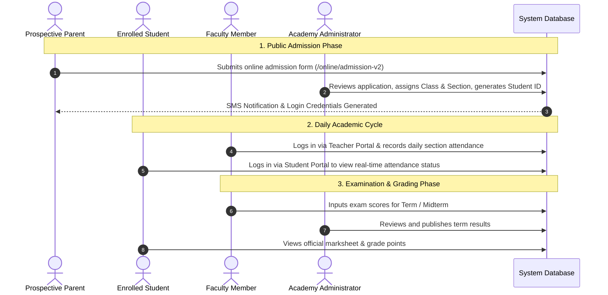

# Naafein International Academy (NIA) - Overall UI Architecture & System Map

> **Institution**: Naafein International Academy (EIIN: 310010467, Estd: 2025)  
> **Reference Website**: [https://www.nia.edu.bd/](https://www.nia.edu.bd/)  
> **Scope**: Complete end-to-end interface map spanning the **Public Web CMS**, **Student Portal**, **Teacher Portal**, and **Admin Backoffice**.

---

## 1. Global Application UI Architecture

The platform is designed around four principal user interface tiers:

```mermaid
graph TD
    classDef public fill:#0f172a,stroke:#38bdf8,stroke-width:2px,color:#fff;
    classDef student fill:#047857,stroke:#10b981,stroke-width:2px,color:#fff;
    classDef teacher fill:#b45309,stroke:#f59e0b,stroke-width:2px,color:#fff;
    classDef admin fill:#4338ca,stroke:#6366f1,stroke-width:2px,color:#fff;

    Gateway[NIA UNIFIED WEB PLATFORM]

    %% Tier 1
    Gateway --> Tier1["1. PUBLIC VISITOR INTERFACE (Unauthenticated)"]:::public
    Tier1 --> P1[Public Homepage & News Ticker]
    Tier1 --> P2[About & Institutional Governance]
    Tier1 --> P3[Academic Routines & Calendars]
    Tier1 --> P4[Curriculum EY, PYP, MYP, Hifz]
    Tier1 --> P5[Digital Admission Portal v2]
    Tier1 --> P6[Media Gallery & Official Blog]

    %% Tier 2
    Gateway --> Tier2["2. STUDENT & PARENT PORTAL (Role: Student)"]:::student
    Tier2 --> S1[Student Academic Overview]
    Tier2 --> S2[Live Attendance Record]
    Tier2 --> S3[Term Results & Marksheets]
    Tier2 --> S4[Class Routine & Period Timetable]
    Tier2 --> S5[Hostel Bed & House Allocation]
    Tier2 --> S6[Fee Due Tracking & Invoices]

    %% Tier 3
    Gateway --> Tier3["3. TEACHER & FACULTY PORTAL (Role: Teacher)"]:::teacher
    Tier3 --> T1[Teacher Daily Schedule]
    Tier3 --> T2[Daily Attendance Entry]
    Tier3 --> T3[Exam Marks Entry & Grading]
    Tier3 --> T4[Assigned Classes & Subjects]
    Tier3 --> T5[Hostel Super / Warden Log]

    %% Tier 4
    Gateway --> Tier4["4. ADMINISTRATIVE BACKOFFICE (Role: SuperAdmin)"]:::admin
    Tier4 --> A1[CMS & Notice Board Publisher]
    Tier4 --> A2[Admission Applications Review]
    Tier4 --> A3[Student & Employee Registry]
    Tier4 --> A4[Academic Structure & Year Config]
    Tier4 --> A5[Institution Info & EIIN Settings]
```

---

## 2. Overall Interface Tier Breakdown

### Tier 1: Public Web Interface
* **Target Audience**: General public, prospective parents, students, education boards, community.
* **Authentication**: None required.
* **Core Pages**:
  * Home (`/`), About (`/history-of-nia`, `/message-from-the-principal`, `/message-from-the-chairman`).
  * Academic (`/academic-calendar`, `/ramadan-calendar`, `/class-routine`, `/result`).
  * Curriculum (`/early-years-ey`, `/primary-years-programme-pyp`, `/middle-year-programme-myp-high-years-programme-hyp`, `/hifzul-quraan-curriculum`).
  * Admission (`/admission-procedure`, `/online/admission-v2`).
  * Gallery (`/gallery`), News & Notices (`/notices`, `/news`, `/events`), Contact (`/contact-us`).

### Tier 2: Student & Guardian Portal
* **Target Audience**: Enrolled students and their parents.
* **Authentication**: Protected via `#studentLoginModal` / credentials.
* **Route Prefix**: `/portal/student/`
* **Features**:
  * Personalized student profile & ID badge verification.
  * Subject-wise exam results, GPA calculations, and downloadable grade cards.
  * Monthly attendance rate & leaves summary.
  * Daily class schedule & period timings.
  * Hostel allotment info (for residential students).

### Tier 3: Teacher & Faculty Portal
* **Target Audience**: Academic faculty, coordinators, and residential house tutors.
* **Authentication**: Protected via `#teacherLoginModal` / credentials.
* **Route Prefix**: `/portal/teacher/`
* **Features**:
  * Period routine view for today's assigned classes.
  * Section-wise student attendance registration with instant submit.
  * Terminal examination marks entry per student per subject.
  * Progress notes and conduct evaluation comments.

### Tier 4: Administrator Backoffice
* **Target Audience**: Academy leadership, administrative officers, IT administrators.
* **Authentication**: High-security multi-factor / admin guard.
* **Route Prefix**: `/admin/`
* **Features**:
  * Review, approve, or reject online admission applications (`/admin/admissions`).
  * Publish and pin notices with PDF attachments (`/admin/notices`).
  * Manage faculty, non-teaching staff, and governing body profiles (`/admin/employees`).
  * Configure academic years, grade sections, and routine slots (`/admin/academics`).
  * Control institute metadata, hotlines, EIIN (`310010467`), and Play Store links.

---

## 3. Cross-Tier Data Flow

