# Naafein International Academy (NIA) - Private Portals ER Diagram

> **Scope**: Database entities strictly powering the **Authenticated Private Portals** (Student Portal, Guardian Portal, Teacher Portal, and Staff Portal).  
> **Trigger Points on Public Site**: `#studentLoginModal` and `#teacherLoginModal`.

---

## 1. Private Portals ER Diagram (Mermaid)

```mermaid
erDiagram
    %% ==========================================
    %% 1. AUTHENTICATION & ACCESS CONTROL
    %% ==========================================
    PORTAL_ROLES ||--o{ PORTAL_USERS : "assigned to"
    PORTAL_USERS ||--o| STUDENT_PROFILES : "has profile"
    PORTAL_USERS ||--o| TEACHER_PROFILES : "has profile"
    PORTAL_USERS ||--o| GUARDIAN_PROFILES : "has profile"

    PORTAL_ROLES {
        bigint id PK
        string role_name "Student, Parent, Teacher, Coordinator"
        string guard_name "student, teacher"
        json permissions
    }

    PORTAL_USERS {
        bigint id PK
        bigint role_id FK
        string login_credential UK "Student Roll / Teacher Username"
        string email UK
        string phone
        string password_hash
        string user_type "student, teacher, guardian"
        boolean is_active
        timestamp last_login_at
    }

    %% ==========================================
    %% 2. STUDENT ACADEMIC ENROLLMENT & GUARDIANS
    %% ==========================================
    GUARDIAN_PROFILES ||--o{ STUDENT_PROFILES : "parent of"
    PORTAL_CLASSES ||--o{ STUDENT_PROFILES : "enrolled in"
    PORTAL_SECTIONS ||--o{ STUDENT_PROFILES : "assigned to"
    STUDENT_PROFILES ||--o{ DAILY_ATTENDANCE : "attendance history"
    STUDENT_PROFILES ||--o{ EXAM_MARKS : "receives marks"
    STUDENT_PROFILES ||--o{ FEE_INVOICES : "billed to"

    STUDENT_PROFILES {
        bigint id PK
        bigint user_id FK
        bigint guardian_id FK
        bigint class_id FK
        bigint section_id FK
        string student_id_number UK
        string roll_number
        string full_name
        date date_of_birth
        string gender "male, female"
        string blood_group
        string avatar_url
        date admission_date
        string enrollment_status "active, suspended, alumni"
    }

    GUARDIAN_PROFILES {
        bigint id PK
        bigint user_id FK
        string father_name
        string mother_name
        string primary_phone
        string emergency_contact
        text residential_address
    }

    %% ==========================================
    %% 3. ACADEMIC STRUCTURE & CLASS ROUTINES
    %% ==========================================
    PORTAL_CLASSES ||--o{ PORTAL_SECTIONS : "has sections"
    PORTAL_CLASSES ||--o{ CURRICULUM_SUBJECTS : "teaches"
    PORTAL_SECTIONS ||--o{ PERIOD_ROUTINES : "timetable for"
    CURRICULUM_SUBJECTS ||--o{ PERIOD_ROUTINES : "subject scheduled"
    TEACHER_PROFILES ||--o{ PERIOD_ROUTINES : "assigned faculty"

    PORTAL_CLASSES {
        bigint id PK
        string class_name "EY, PYP-1 to 5, MYP, HYP, Hifz"
        string class_level
    }

    PORTAL_SECTIONS {
        bigint id PK
        bigint class_id FK
        string section_name "Section A, Section B, Boys, Girls"
        string room_number
    }

    CURRICULUM_SUBJECTS {
        bigint id PK
        bigint class_id FK
        string subject_code UK
        string subject_title "Arabic, Tajweed, Mathematics, English"
        decimal full_marks
        decimal pass_marks
    }

    PERIOD_ROUTINES {
        bigint id PK
        bigint section_id FK
        bigint subject_id FK
        bigint teacher_id FK
        string day_of_week "Sunday to Thursday"
        time period_start
        time period_end
        string classroom_no
    }

    %% ==========================================
    %% 4. TEACHER FACULTY MANAGEMENT
    %% ==========================================
    TEACHER_PROFILES ||--o{ DAILY_ATTENDANCE : "recorded by"
    TEACHER_PROFILES ||--o{ EXAM_MARKS : "submitted by"

    TEACHER_PROFILES {
        bigint id PK
        bigint user_id FK
        string teacher_code UK
        string full_name
        string designation "Coordinator, Senior Teacher, Assistant Teacher"
        string department "Academic, Hifz, Islamic Studies"
        string phone_number
        string official_email
        string qualification
        boolean is_class_teacher
    }

    %% ==========================================
    %% 5. DAILY ATTENDANCE TRACKING
    %% ==========================================
    PORTAL_SECTIONS ||--o{ DAILY_ATTENDANCE : "class attendance"

    DAILY_ATTENDANCE {
        bigint id PK
        bigint section_id FK
        bigint student_id FK
        bigint recorded_by_teacher_id FK
        date attendance_date
        string status "present, absent, late, excused"
        text remarks
        timestamp recorded_at
    }

    %% ==========================================
    %% 6. EXAMINATIONS, MARKS & REPORT CARDS
    %% ==========================================
    PORTAL_EXAMS ||--o{ EXAM_MARKS : "graded under"
    CURRICULUM_SUBJECTS ||--o{ EXAM_MARKS : "subject tested"

    PORTAL_EXAMS {
        bigint id PK
        string exam_title "1st Term, Half Yearly, Annual, Quran Evaluation"
        date start_date
        date end_date
        boolean is_published
    }

    EXAM_MARKS {
        bigint id PK
        bigint exam_id FK
        bigint student_id FK
        bigint subject_id FK
        bigint teacher_id FK
        decimal marks_obtained
        decimal highest_marks_in_class
        string letter_grade "A+, A, A-, B, C, F"
        decimal grade_point "5.00, 4.00, etc."
        text teacher_remarks
        timestamp submitted_at
    }

    %% ==========================================
    %% 7. FEES, INVOICES & HOSTEL
    %% ==========================================
    FEE_INVOICES {
        bigint id PK
        bigint student_id FK
        string invoice_number UK
        string fee_month "January 2026"
        decimal tuition_fee
        decimal hostel_fee
        decimal total_amount
        decimal paid_amount
        string payment_status "unpaid, partial, paid"
        date due_date
        timestamp paid_at
    }

    HOSTEL_ROOMS ||--o{ HOSTEL_RESIDENTS : "allocated bed"
    STUDENT_PROFILES ||--o| HOSTEL_RESIDENTS : "resident student"

    HOSTEL_ROOMS {
        bigint id PK
        string hostel_wing "Naafein Al Hidayah Boys/Girls"
        string room_no
        int bed_count
        int available_beds
    }

    HOSTEL_RESIDENTS {
        bigint id PK
        bigint hostel_room_id FK
        bigint student_id FK
        date allotment_date
        string bed_label
        string status "active, vacated"
    }
```

---

## 2. Private Portal Entity Summary

| Subsystem | Core Entities | Responsibilities |
| :--- | :--- | :--- |
| **Portal IAM** | `PORTAL_USERS`, `PORTAL_ROLES` | Handles multi-guard authentication for students (via ID/Roll) and teachers (via username). |
| **Student Record** | `STUDENT_PROFILES`, `GUARDIAN_PROFILES` | Houses private student bios, roll numbers, emergency contacts, and residential addresses. |
| **Timetable & Routine** | `PERIOD_ROUTINES`, `PORTAL_SECTIONS` | Controls period-by-period timetables accessible in the Student and Teacher Portals. |
| **Attendance Register** | `DAILY_ATTENDANCE` | Faculty marks student status daily; students view live attendance percentages. |
| **Grading & Marksheet** | `PORTAL_EXAMS`, `EXAM_MARKS` | Supports teacher mark entry and compiles student term marksheets and GPAs. |
| **Fees & Invoices** | `FEE_INVOICES` | Tracks monthly tuition, exam, and hostel fees with payment status. |
| **Hostel & Dormitory** | `HOSTEL_ROOMS`, `HOSTEL_RESIDENTS` | Tracks bed allotments for *Naafein Al Hidayah Hostel* boarders. |
