# Naafein International Academy (NIA) - Private Portals UI Map

> **Scope**: Screen hierarchy and interface workflows for **Student Portal** and **Teacher Portal**.  
> **Status**: *Initial Architecture & Wireframe Map (Awaiting live user credentials for deep inspection)*.

---

## 1. Private Portals Screen Architecture

```mermaid
graph TD
    classDef auth fill:#1e293b,stroke:#64748b,stroke-width:1px,color:#fff;
    classDef student fill:#047857,stroke:#10b981,stroke-width:2px,color:#fff;
    classDef teacher fill:#b45309,stroke:#f59e0b,stroke-width:2px,color:#fff;

    %% Login Modals (Public Triggers)
    S_Modal[#studentLoginModal: Student ID & DOB/Password]:::auth
    T_Modal[#teacherLoginModal: Teacher Username & Password]:::auth

    %% Student Portal Pages
    S_Modal --> S_Dash[Student Portal Dashboard]:::student
    S_Dash --> S_Att[Attendance Analytics Screen<br/>• Monthly Present/Absent/Late<br/>• Overall Attendance %]:::student
    S_Dash --> S_Res[Results & Grade Card Screen<br/>• Term Exams Selection<br/>• Subject-wise Marks & GPA<br/>• Printable Marksheet PDF]:::student
    S_Dash --> S_Rout[My Class Routine Screen<br/>• Period-by-period Timetable<br/>• Assigned Subject & Teacher]:::student
    S_Dash --> S_Fee[Fee Statements & Invoices<br/>• Paid & Pending Dues<br/>• Payment Receipts]:::student
    S_Dash --> S_Host[Hostel Information Screen<br/>• Room No, Bed Allotment<br/>• House Master Contact]:::student

    %% Teacher Portal Pages
    T_Modal --> T_Dash[Teacher Portal Dashboard]:::teacher
    T_Dash --> T_Sched[Today's Class Schedule<br/>• Next Period Countdown<br/>• Section & Room Number]:::teacher
    T_Dash --> T_AttReg[Daily Attendance Register<br/>• Select Class & Section<br/>• One-Click Present/Absent<br/>• Bulk Save to Database]:::teacher
    T_Dash --> T_Mark[Exam Marks Entry Screen<br/>• Select Term & Subject<br/>• Numerical Score Inputs<br/>• Validation & Final Submission]:::teacher
    T_Dash --> T_Comm[Student Notes & Conduct Remarks<br/>• Behavioral & Hifz Progress]:::teacher
```

---

## 2. Student Portal (`/portal/student/*`) Detailed UI Map

### 1. Dashboard Overview (`/portal/student/dashboard`)
* **Student Identity Header**: Student Avatar, Full Name, Class, Section, Roll Number, and Registration Card badge.
* **Metric Cards**:
  * Attendance Rate (e.g., `94.5%`).
  * Latest GPA / Exam Position.
  * Today's Class Count (`5 Periods`).
  * Fee Status (`Paid` / `Unpaid Dues`).
* **Upcoming Periods**: Live card showing today's remaining class periods and rooms.
* **School Announcements**: Targeted student notices.

### 2. Attendance Tracker (`/portal/student/attendance`)
* **Monthly Calendar Grid**: Color-coded days (Green = Present, Red = Absent, Yellow = Late).
* **Summary Stats**: Total working days, presents, excused leaves, and percentage score.

### 3. Term Results & Marksheets (`/portal/student/results`)
* **Exam Selector**: Dropdown (`1st Term Exam 2026`, `Mid-Term Exam`, `Annual Exam`, `Hifz Evaluation`).
* **Report Card Table**:
  * Columns: Subject Code, Subject Name, Full Marks, Obtained Marks, Grade Letter, Grade Point.
  * Bottom Summary: Total Marks, Overall GPA, Remarks from Principal.
  * **[Print / Download PDF Marksheet]** action button.

### 4. Class Timetable (`/portal/student/routine`)
* Weekly schedule table spanning Sunday through Thursday (7:50 AM to 4:00 PM).
* Each slot includes: Subject title, assigned teacher name, and classroom number.

### 5. Fee Statements (`/portal/student/fees`)
* Itemized monthly tuition, admission fees, and hostel fees.
* Invoice history with date stamps and receipt download buttons.

---

## 3. Teacher Portal (`/portal/teacher/*`) Detailed UI Map

### 1. Dashboard Overview (`/portal/teacher/dashboard`)
* **Faculty Profile Card**: Photo, Designation, Assigned Department, and Class Teacher status.
* **Today's Classes List**: Chronological timeline of periods to conduct today.
* **Pending Actions**: Reminders for unmarked attendance or unsubmitted exam marks.

### 2. Daily Attendance Register (`/portal/teacher/attendance`)
* **Filter Bar**: Select Date, Class, and Section.
* **Roster Table**:
  * Student Roll, Photo, Full Name.
  * Radio options: `Present` | `Absent` | `Late` | `Excused`.
  * "Mark All Present" quick toggle.
* **Action**: `[Submit Attendance Register]` with success confirmation toastr.

### 3. Examination Marks Entry (`/portal/teacher/marks`)
* **Filter Bar**: Select Academic Year, Exam Term, Class, Section, and Subject.
* **Mark Sheet Input Form**:
  * List of enrolled students with input fields for:
    * Written Marks
    * Viva / Oral / Tajweed Marks
    * Total Calculated Marks (auto-computed)
    * Teacher Remarks (e.g., "Excellent Quran recitation").
* **Action**: `[Save Draft]` and `[Finalize & Submit to Exam Controller]`.

---

## 4. Pending Live Verification Notice

> **Note**: This architecture map reflects the standard schemas and API requirements implemented in the backend code. Detailed screen captures and DOM inspection will be updated in this file as soon as live test credentials for the Student and Teacher Portals are provided.
