# Naafein International Academy (NIA) - Public Website ER Diagram

> **Scope**: Database entities strictly powering the **Public Website & Visitor CMS** at [https://www.nia.edu.bd/](https://www.nia.edu.bd/).  
> **Target Audience**: Visitors, prospective parents, students, and general community without authentication.

---

## 1. Public CMS & Website ER Diagram (Mermaid)

```mermaid
erDiagram
    %% ==========================================
    %% 1. INSTITUTION & METADATA
    %% ==========================================
    INSTITUTE_SETTINGS ||--o{ HERO_SLIDERS : "showcases"
    INSTITUTE_SETTINGS ||--o{ CONTACT_MESSAGES : "receives"

    INSTITUTE_SETTINGS {
        bigint id PK
        string school_name "NAAFEIN INTERNATIONAL ACADEMY"
        string eiin_number "310010467"
        string established_year "2025"
        string hotline_numbers "01805023220-22"
        string email_address "info@nia.edu.bd"
        text campus_address "House #36, Road #06, Arambag, Mirpur #07, Dhaka-1216"
        string logo_url
        string favicon_url
        string facebook_page_url "https://www.facebook.com/NIAcademy2024"
        string youtube_channel_url
        string playstore_app_id "com.teamx.edteco.app"
        text principal_message_excerpt
        text principal_message_full
        text chairman_message_excerpt
        text chairman_message_full
    }

    HERO_SLIDERS {
        bigint id PK
        string title
        string image_url
        string caption
        int sort_order
        boolean is_active
    }

    CONTACT_MESSAGES {
        bigint id PK
        string sender_name
        string sender_email
        string sender_phone
        string subject
        text message_body
        boolean is_read
        boolean is_replied
        timestamp submitted_at
    }

    %% ==========================================
    %% 2. CONTENT & NOTICE BOARD
    %% ==========================================
    CMS_CATEGORIES ||--o{ NOTICES : "categorizes"
    CMS_CATEGORIES ||--o{ POSTS : "categorizes"

    CMS_CATEGORIES {
        bigint id PK
        string name "Notice, News, Event, Blog, Co-Curricular"
        string slug UK
        string description
    }

    NOTICES {
        bigint id PK
        bigint category_id FK
        string title
        text content
        string pdf_attachment_url
        date publish_date
        boolean is_pinned "Appears on Home Widget"
        boolean is_published
        int view_count
    }

    POSTS {
        bigint id PK
        bigint category_id FK
        string title
        string slug UK
        text excerpt
        longtext body_content
        string thumbnail_image
        date event_schedule_date
        string post_type "news, event, blog"
        boolean is_featured
        boolean is_published
        timestamp published_at
    }

    %% ==========================================
    %% 3. PUBLIC MEDIA & GALLERIES
    %% ==========================================
    PHOTO_ALBUMS ||--o{ GALLERY_IMAGES : "contains"

    PHOTO_ALBUMS {
        bigint id PK
        string album_title "Annual Sports, Field Trip, Hifz Department"
        string cover_image_url
        date event_date
        int total_photos
    }

    GALLERY_IMAGES {
        bigint id PK
        bigint album_id FK
        string image_url
        string caption
        int sort_order
    }

    VIDEO_CONTENTS {
        bigint id PK
        string title "Prof Dr Md Mahmudul Hassan's Address"
        string youtube_video_id "PUFiA9UX1yU, 1lVm1XTtLao"
        string thumbnail_url
        int sort_order
        boolean is_featured "Shown in Splide Carousel"
    }

    %% ==========================================
    %% 4. PUBLIC FACULTY DIRECTORY & ADMISSION PIPELINE
    %% ==========================================
    PUBLIC_PROGRAMS ||--o{ PUBLIC_ADMISSION_APPLICATIONS : "targeted grade"

    PUBLIC_TEACHERS {
        bigint id PK
        string name "Syeda Tanzima Shajia, Abdullah An Nafiu Ansary"
        string designation_title "Coordinator, Assistant Teacher, Co Teacher"
        string department "Academic, Hifz, Administration"
        string gender "male, female"
        string photo_url
        string qualification
        string staff_category "teaching, committee"
        int sort_order
        boolean is_active
    }

    PUBLIC_PROGRAMS {
        bigint id PK
        string program_name "Early Years (EY), PYP, MYP, HYP, Hifz"
        string program_code UK
        string age_group
        text description
    }

    PUBLIC_ADMISSION_APPLICATIONS {
        bigint id PK
        bigint program_id FK
        string application_number UK
        string candidate_name
        date dob
        string gender
        string blood_group
        string guardian_name
        string guardian_phone
        string guardian_email
        text address
        string previous_school
        string payment_status "unpaid, paid"
        string application_status "pending, approved, rejected"
        string document_attachments
        timestamp submitted_at
    }
```

---

## 2. Public UI Table Mapping

| Website Component | Underlying Tables | Purpose |
| :--- | :--- | :--- |
| **Header & Top Bar** | `INSTITUTE_SETTINGS` | Displays official contacts, EIIN, address, and social links. |
| **Hero Slider** | `HERO_SLIDERS` | Serves banner images with automated autoplay. |
| **Notice Board Widget** | `NOTICES`, `CMS_CATEGORIES` | Serves pinned and recent circulars with PDF download triggers. |
| **Leadership Messages** | `INSTITUTE_SETTINGS` | Displays Principal's and Chairman's formal messages. |
| **Faculty Directory** | `PUBLIC_TEACHERS` | Powers the `/get-teachers` AJAX grid and homepage slider. |
| **Event Countdown & News** | `POSTS`, `CMS_CATEGORIES` | Displays upcoming event cards with day badges. |
| **Video Gallery** | `VIDEO_CONTENTS` | YouTube thumbnail grid triggering the `#ytModal` lightbox. |
| **Photo Gallery** | `PHOTO_ALBUMS`, `GALLERY_IMAGES` | Powers continuous gallery sliders and album detail pages. |
| **Online Admission** | `PUBLIC_PROGRAMS`, `PUBLIC_ADMISSION_APPLICATIONS` | Manages the multi-step public application form (`/online/admission-v2`). |
| **Contact Form** | `CONTACT_MESSAGES` | Collects public queries submitted from `/contact-us`. |
